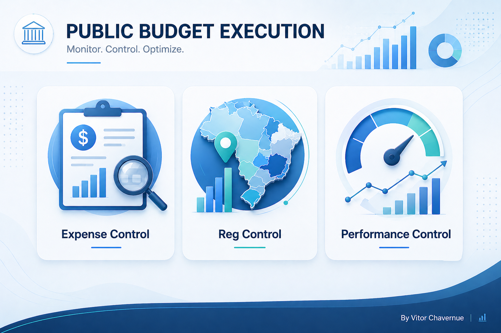
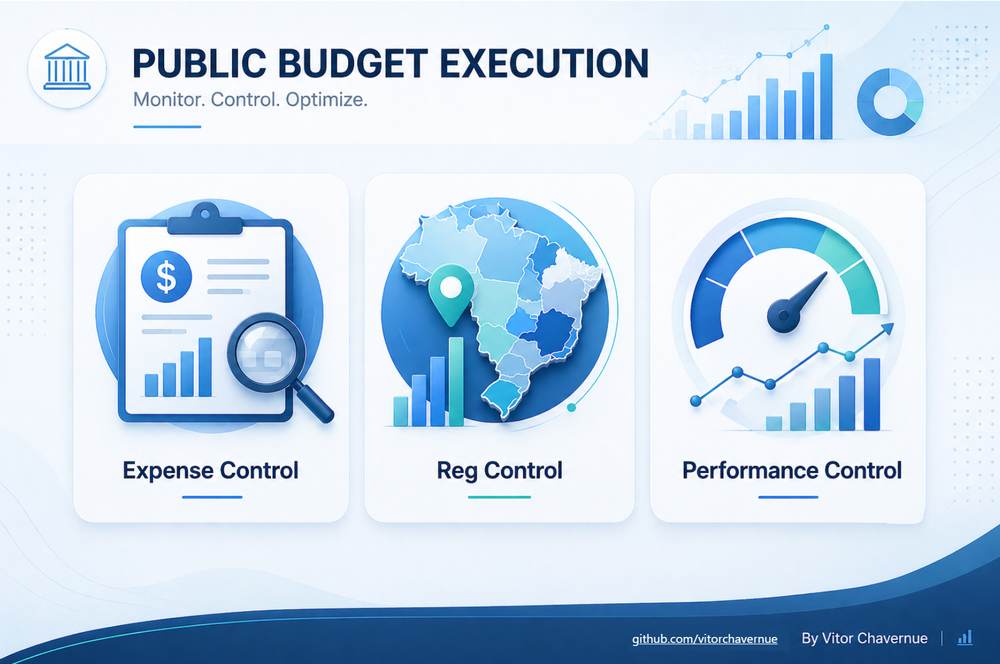
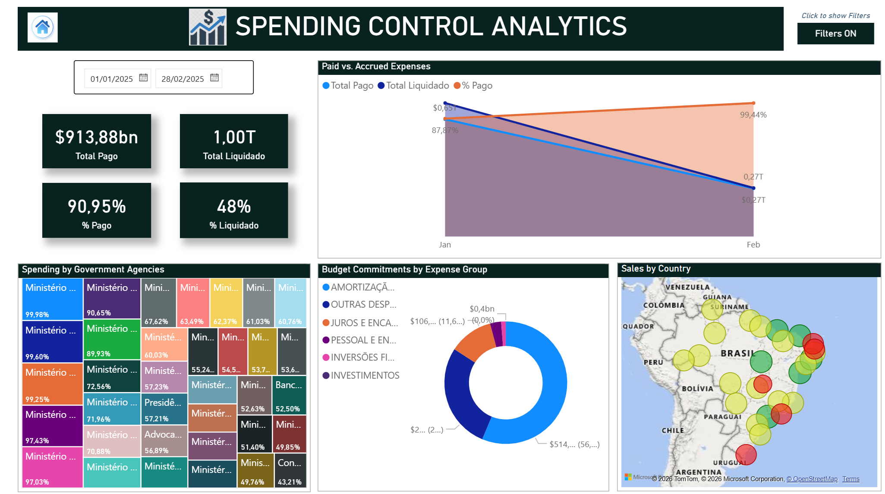
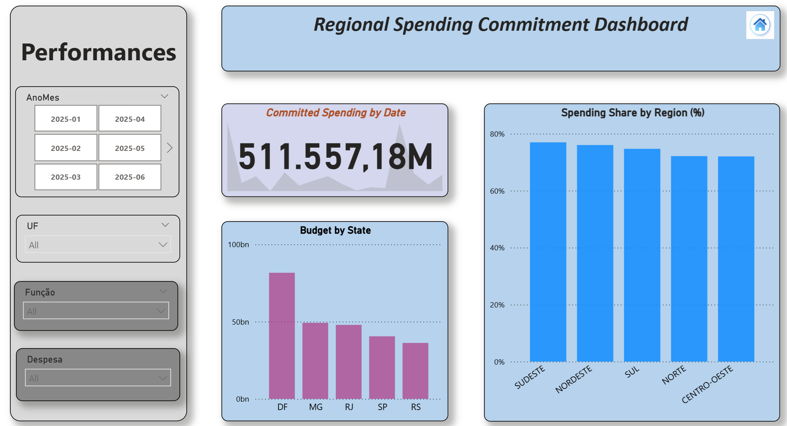
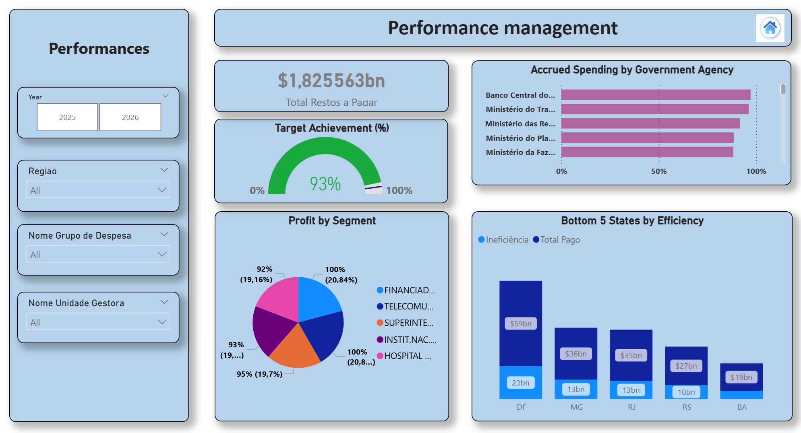

# 📊 Public Budget Execution Dashboard (Power BI)

A professional Power BI dashboard designed to analyze Brazilian public expenditure, focusing on budget execution, regional distribution, and performance monitoring.

---

## 🚀 Overview

This project provides a comprehensive analytical view of public spending using official Brazilian government data. It enables users to explore how budget resources are committed, liquidated, and paid across different regions and government agencies.

The solution follows best practices in data modeling, DAX calculations, and UI/UX design, delivering a clean and interactive experience.

---

## 📊 Dashboard Preview

  
  
  

---

## 🎯 Key Features

- 📌 **Expense Control**
  - Total spending analysis
  - Committed vs Paid comparison
  - Time-based trends (YTD, Monthly)

- 🌎 **Regional Control**
  - Spending by region and state
  - Geographic visualization (map)
  - Regional distribution insights

- 📈 **Performance Control**
  - Target Achievement (%)
  - KPI monitoring
  - Efficiency indicators

- 🎛️ **Interactivity**
  - Navigation buttons (Home experience)
  - Bookmark-based dynamic views
  - Clean and modern UI

---

## 📂 Data Source

Data was extracted from the official Brazilian Transparency Portal:

🔗 https://portaldatransparencia.gov.br

Dataset used:
- Public expenditure execution data (Despesas – Execução), monthly files from **01/2025 to 04/2026**

To keep the repository lightweight, only a **sample** of the raw data is versioned (`DataSet/sample/`). The full monthly files can be downloaded from the portal (*Download de dados → Despesas → Execução*) and saved to `DataSet/Despesas20252026/` to refresh the report. The `.pbix` file already contains the imported data, so it can be explored without downloading anything.

---

## 🧠 Data Model

The project follows a **Star Schema** approach:

- **Fact Table**
  - `Fato_Despesas`

- **Dimensions**
  - `Dim_Calendario`
  - `Dim_Orgao`
  - `Dim_Geografia`
  - `Dim_Grupo_Despesa`

This structure ensures:
- High performance
- Scalability
- Clear relationships (1:N)

---

## 📈 Key Metrics (DAX)

Some of the main measures implemented:

- **Total Spending**
- **Committed Amount**
- **Paid Amount**
- **Spending YTD**
- **Spending YoY %**
- **Target Achievement (%)**
- **Spending by Region (%)**

---

## 🏗️ Technical Highlights

- Data transformation using **Power Query (M)**
- Advanced calculations using **DAX**
- Proper handling of:
  - Null values
  - Text standardization
  - Date normalization
- Use of:
  - Bookmarks for navigation
  - Custom layout and UI design
  - Optimized visuals for performance

---

## ▶️ How to Use

1. Download the `.pbix` file from this repository  
2. Open using Power BI Desktop  
3. Refresh data if necessary  
4. Navigate through the dashboard using the home buttons  

---

## 🎨 UI/UX Design

The dashboard was designed with a focus on:

- Clean and modern layout  
- Consistent color palette  
- Clear hierarchy of information  
- Executive-level readability  

---

## 📌 Project Objective

The main goal of this project is to:

- Demonstrate advanced Power BI skills  
- Apply real-world public data  
- Build a professional BI portfolio project  

---

## 👤 Author

**Vitor Chavernue** — Senior Data Engineer & Data Analyst
[LinkedIn](https://www.linkedin.com/in/vitorchavernue/) · [GitHub](https://github.com/vitorchavernue)

---

## 📄 License

This project is for portfolio and educational purposes.